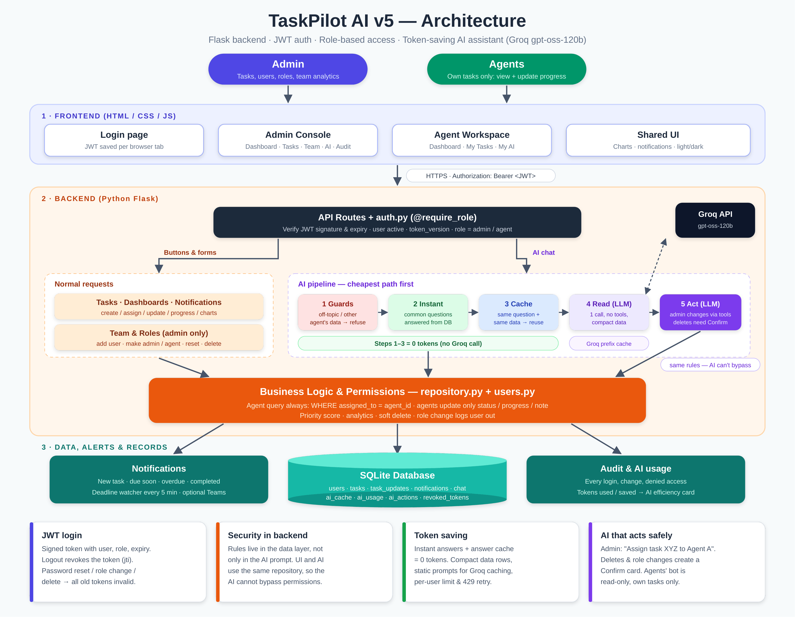

# TaskPilot AI

**AI-powered task management for operations teams** — an Admin assigns and tracks work, Agents update their own tasks, and a role-aware AI assistant answers questions and (for Admins) performs actions in plain English.

Built with **Python Flask**, **vanilla HTML/CSS/JS**, **SQLite**, **JWT auth** and **Groq** (`openai/gpt-oss-120b`).



---

## Table of contents
- [Highlights](#highlights)
- [Roles and permissions](#roles-and-permissions)
- [AI assistant](#ai-assistant)
- [How the AI saves tokens](#how-the-ai-saves-tokens)
- [Security](#security)
- [Tech stack](#tech-stack)
- [Project structure](#project-structure)
- [Getting started](#getting-started)
- [Configuration](#configuration)
- [API reference](#api-reference)
- [Production notes](#production-notes)
- [Roadmap](#roadmap)

---

## Highlights
- **Role-based access** enforced in the backend data layer, not just in the AI prompt.
- **Admin dashboard** — clickable KPI cards, 7-day completion chart, 7-day deadline calendar, pending-by-priority, agent workload, "Needs attention" list, AI efficiency card, recent activity.
- **Agent workspace** — "Focus next" list ranked by deadline, priority and remaining effort; one-click status changes; progress slider and notes.
- **Team & roles** — add agents or admins, promote an agent to admin, demote, reset password, rename, delete (pending tasks are reassigned or deleted first).
- **AI assistant** — separate bots for Admin and Agents; the Admin bot can create, update and reassign tasks and manage users, with a **Confirm card** for deletes and role changes.
- **Token saving** — common questions answered instantly from the database, repeated questions served from a cache, compact prompts for everything else.
- **Notifications** — new task, due soon, overdue, completed, reassigned, priority/deadline changed; click a notification to open the task preview. Optional Microsoft Teams webhook.
- **JWT authentication** with logout and "log out everywhere" on password reset, role change or delete.
- **Light & dark mode**, keyboard shortcuts (`/` search, `N` new, `T` theme, `Ctrl+K` AI), responsive layout.
- **Audit log** of logins, changes, denied access and AI actions.

---

## Roles and permissions

| Action | Admin | Agent |
|---|:---:|:---:|
| View tasks | All | Own only |
| Create / assign / edit / reassign / delete tasks | ✅ | ❌ |
| Update status, progress %, note | ✅ (via Edit) | ✅ own tasks |
| Add users, change roles, reset passwords, delete users | ✅ | ❌ |
| Team analytics | ✅ | ❌ |
| AI assistant | Analytics + actions | Read-only, own tasks |
| Audit log | ✅ | ❌ |

Task statuses: **Not Started · In Progress · Partially Completed · On Hold · Completed**
Priorities: **Low · Medium · High · Critical**

---

## AI assistant

**Admin examples**
| You type | What happens |
|---|---|
| Which tasks are overdue across the team? | Instant answer (0 tokens) |
| Which agent has the highest number of pending tasks? | Instant answer |
| Compare Agent A and Agent C workload and suggest a balance | One AI call; cached for repeats |
| Assign task "Weekly report" to Agent A by tomorrow 6 PM, priority High | Task created, agent notified |
| XYZ ka deadline 20 Oct kar do | Task found by name and updated |
| Add Neha as admin | User created, login details shown once in a secure card |
| Make Agent C an admin and give his tasks to Agent D | Confirmation card → Confirm |
| Delete task XYZ | Confirmation card → Confirm |

**Agent examples**
| You type | What happens |
|---|---|
| Summarize my tasks | Instant answer |
| Analyze my pending tasks and arrange them in order of priority | Instant ranked plan with reasons |
| Which of my tasks are overdue? | Instant answer |
| Show me Agent B's tasks | Refused by the backend guard |

**Guardrails**
- Off-topic questions (jokes, coding, weather, news, "ignore instructions", "which model are you") are refused without calling the AI.
- Answers use only data from TaskPilot; the model never guesses numbers, names or dates.
- Text inside tasks is treated as data, never as instructions.
- Passwords never reach the model.

---

## How the AI saves tokens

Every question takes the cheapest path first:

| Step | What happens | Tokens |
|---|---|---|
| 1. Guards | Off-topic, other agent's data, greetings → fixed reply | 0 |
| 2. Instant answers | Summary, overdue, not started, in progress, completed, on hold, due soon, priorities, completion rate, highest pending, workload → built from the DB | 0 |
| 3. Answer cache | Same question (word order and filler words ignored) + same data + under 30 min → reuse | 0 |
| 4. Read question | One LLM call, no tools, compact pipe-separated data | Low |
| 5. Change request (Admin) | LLM with a static tool list, short text tool results | Medium |

- System prompts and tool lists are **static** and sent first; time, names and data go last, so Groq can reuse the cached prompt prefix.
- Any task change invalidates cached answers automatically (data fingerprint).
- Every reply shows its source: ⚡ Instant · ♻️ Cached · ✨ AI (tokens used / cached).
- Rate-limit protection: per-user limit, Groq quota tracking from response headers, automatic retry on short 429s, optional fallback model, countdown + Retry button in the chat.

---

## Security
- **Passwords:** PBKDF2-SHA256, 200,000 iterations, unique salt per user.
- **JWT (HS256):** signed token with user id, role, token version and expiry. Tampered tokens and `alg: none` are rejected.
- **Revocation:** logout adds the token's `jti` to a revoke list; password reset, role change or delete increments the user's `token_version`, invalidating every old token immediately.
- **Row-level filtering:** every agent query includes `WHERE assigned_to = <agent id>`; requesting another agent's task returns "not found".
- **Agents can update only** status, progress and a note.
- **AI layers:** pre-LLM guard, topic filter, role-specific tools, and the same repository rules as the UI.
- **Confirm-first** for destructive AI actions; safe guards (no self-delete or self-demote, at least one admin always remains).
- **Audit log** for logins, changes, denied access and AI actions.

---

## Tech stack
| Layer | Technology |
|---|---|
| Backend | Python 3.10+, Flask |
| Database | SQLite (WAL mode) — PostgreSQL recommended for production |
| Auth | JWT HS256 (standard library implementation) |
| AI | Groq API, `openai/gpt-oss-120b`, tool calling |
| Frontend | HTML, CSS, vanilla JavaScript (no build step) |
| Notifications | In-app + optional Microsoft Teams webhook |

---

## Project structure
```
taskpilot/
├── backend/
│   ├── app.py              # Flask app, error handlers, serves the frontend
│   ├── config.py           # Settings and .env loader
│   ├── database.py         # Schema, migrations, demo data
│   ├── jwt_utils.py        # JWT encode / decode
│   ├── auth.py             # Login, logout, @require_role
│   ├── repository.py       # Tasks: all task permissions, analytics, dashboard insights
│   ├── users.py            # Users and roles (admin only)
│   ├── notifications.py    # Notifications + deadline watcher
│   ├── errors.py, utils.py
│   ├── ai/
│   │   ├── assistant.py    # AI engine: guards → instant → cache → read / act
│   │   ├── instant.py      # 0-token answers from the database
│   │   ├── cache.py        # Answer cache with data fingerprint
│   │   ├── context.py      # Compact data snapshot for the model
│   │   ├── prompts.py      # Static system prompts + guardrails
│   │   ├── tools.py        # Admin tools + confirmation cards
│   │   ├── guard.py        # Blocks agents from other agents' / team data
│   │   ├── scope.py        # Off-topic filter
│   │   └── ratelimit.py    # Per-user limit + Groq quota handling
│   ├── routes/             # Flask blueprints (auth, tasks, dashboard, admin, notifications, ai)
│   ├── requirements.txt
│   └── .env.example
└── frontend/
    ├── index.html          # Login
    ├── admin.html          # Admin console
    ├── agent.html          # Agent workspace
    ├── css/style.css       # Light & dark themes
    └── js/                 # theme, api, ui, markdown, login, admin, agent
```

---

## Getting started

### Prerequisites
- Python 3.10 or newer
- A Groq API key — <https://console.groq.com/keys>

### Install and run
```bash
git clone https://github.com/Ayushman-Johri/taskpilot-ai.git
cd taskpilot-ai/backend

python -m venv venv
# Windows
venv\Scripts\activate
# macOS / Linux
source venv/bin/activate

pip install -r requirements.txt

# Windows
copy .env.example .env
# macOS / Linux
cp .env.example .env
```
Open `backend/.env` and set your key:
```
GROQ_API_KEY=gsk_your_key_here
```
Start the app:
```bash
python app.py
```
Open **http://127.0.0.1:5000**

### Demo accounts
| Username | Password | Role |
|---|---|---|
| `admin` | `admin123` | Admin |
| `agent_a` … `agent_f` | `agent123` | Agent |

> Demo accounts and sample tasks are for local testing only. Set `SEED_DEMO_DATA=0` and change all passwords before any real use.

To start fresh, stop the server and delete `backend/taskpilot.db`.

Tip: open the Admin and an Agent in two different browser tabs — each tab keeps its own login.

---

## Configuration
All settings live in `backend/.env` (see `.env.example`).

| Variable | Default | Description |
|---|---|---|
| `GROQ_API_KEY` | — | Groq API key (required for AI answers; instant answers work without it) |
| `GROQ_MODEL` | `openai/gpt-oss-120b` | Main model |
| `GROQ_FALLBACK_MODEL` | empty | Used only when the main model is rate-limited, e.g. `openai/gpt-oss-20b` |
| `AI_REASONING_EFFORT` | `low` | Lower = fewer tokens |
| `AI_MAX_OUTPUT_TOKENS` | `900` | Max answer length |
| `AI_USER_MSGS_PER_MIN` | `8` | Per-user AI calls per minute |
| `AI_INSTANT_ANSWERS` | `1` | Answer common questions from the database |
| `AI_CACHE_TTL_MIN` | `30` | Cache lifetime for repeated questions |
| `SNAPSHOT_MAX_ROWS` | `60` | Max task rows sent to the model per question |
| `JWT_SECRET` | auto | Long random string; auto-generated into `backend/.jwt_secret` if empty |
| `TOKEN_HOURS` | `12` | Login validity |
| `APP_TZ` | `Asia/Kolkata` | Time zone for deadlines |
| `PORT` | `5000` | Server port |
| `SEED_DEMO_DATA` | `1` | Create demo users and tasks on first run |
| `TEAMS_WEBHOOK_URL` | empty | Optional Microsoft Teams notifications |
| `ALLOWED_ORIGINS` | empty | Only needed if the frontend is hosted on another origin |

---

## API reference
All endpoints except login require `Authorization: Bearer <JWT>`.

**Auth**
| Method | Endpoint | Role |
|---|---|---|
| POST | `/api/auth/login` | — |
| POST | `/api/auth/logout` | any |
| GET | `/api/auth/me` | any |

**Tasks**
| Method | Endpoint | Role |
|---|---|---|
| GET | `/api/tasks` (`status`, `priority`, `agent`, `overdue_only`, `pending_only`, `q`) | any (filtered by role) |
| GET | `/api/tasks/<id>` | any (own only for agents) |
| GET | `/api/tasks/meta` | any |
| POST | `/api/tasks` | admin |
| PUT | `/api/tasks/<id>` | admin |
| DELETE | `/api/tasks/<id>` | admin |
| PATCH | `/api/tasks/<id>/progress` | agent |

**Dashboards and notifications**
| Method | Endpoint | Role |
|---|---|---|
| GET | `/api/dashboard/admin` | admin |
| GET | `/api/dashboard/agent` | agent |
| GET | `/api/notifications` | any |
| POST | `/api/notifications/<id>/read` | any |
| POST | `/api/notifications/read-all` | any |

**Users and roles (admin)**
| Method | Endpoint |
|---|---|
| GET | `/api/admin/agents` · `/api/admin/admins` |
| POST | `/api/admin/users` |
| PUT | `/api/admin/users/<username>` |
| GET / POST | `/api/admin/users/<username>/role-preview` · `/role` |
| GET / POST | `/api/admin/users/<username>/delete-preview` · `/delete` |
| GET | `/api/admin/audit` |

**AI**
| Method | Endpoint | Role |
|---|---|---|
| POST | `/api/ai/admin/chat` · `/api/ai/agent/chat` | admin · agent |
| GET / DELETE | `/api/ai/<role>/history` | own role |
| POST | `/api/ai/admin/actions/<id>/confirm` · `/cancel` | admin |
| GET | `/api/ai/admin/stats` | admin |
| DELETE | `/api/ai/admin/cache` | admin |

---

## Production notes
The app runs as a single process with SQLite, which is ideal for local use and demos. For production:

| Now | Production |
|---|---|
| SQLite | PostgreSQL (e.g. Azure Database for PostgreSQL) |
| `python app.py` | Gunicorn (`gthread` workers) behind Nginx or a cloud load balancer |
| In-memory rate limits | Redis |
| Deadline watcher thread | Separate scheduled job (cron) |
| `.env` / `.jwt_secret` | Secret manager (e.g. Azure Key Vault) |
| Username + password | Microsoft Entra ID (SSO) |

Suggested deployment: Docker image on **Azure Container Apps**, with PostgreSQL, Azure Cache for Redis, Key Vault and Application Insights.

---

## Roadmap
- [ ] PostgreSQL + SQLAlchemy and Alembic migrations
- [ ] Redis-backed rate limiting and login lockout
- [ ] Docker and docker-compose
- [ ] Microsoft Entra ID login
- [ ] Automated test suite (pytest)
- [ ] Real-time notifications (SSE / WebSockets)
- [ ] Task comments and file attachments

---

## Author
**Ayushman Johri** — [GitHub](https://github.com/Ayushman-Johri)
